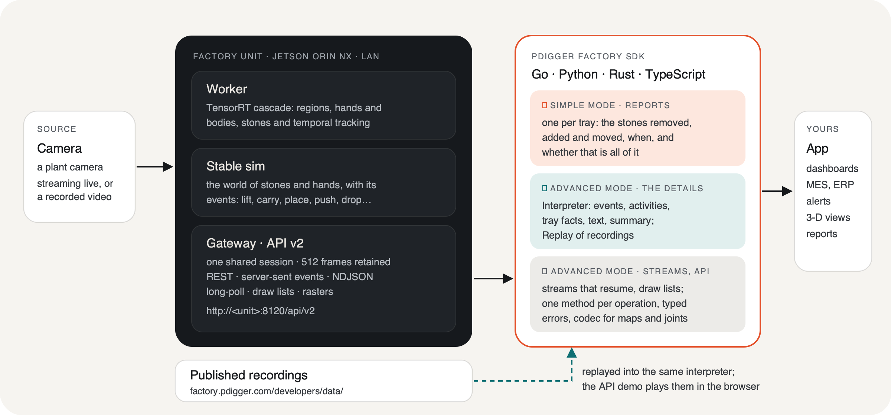

# pDigger Factory SDK for Python

Read tray reports from a pDigger Factory camera unit or replay a recording in Python. Live reads use `asyncio`. You
can read a file with a regular `for` loop.

Simple mode gives you one report per tray. It lists the stones added, removed or moved and flags uncertain changes.
Advanced mode gives you the events, frames and tracking evidence behind each report.

[Explore a recorded tray in 3D](https://eprojac.github.io/pdigger-factory-sdk-python/)
or [get the notebook and offline viewer](https://github.com/eprojac/pdigger-factory-sdk-python/tree/main/notebooks).

## Install

Use Python 3.10 or later. Install the SDK in a virtual environment to try the examples.

```sh
git clone https://github.com/eprojac/pdigger-factory-sdk-python
cd pdigger-factory-sdk-python
python3 -m venv .venv
. .venv/bin/activate
python -m pip install .
```

If you only need the library, install it directly with
`python -m pip install "pdigger-factory-sdk @ git+https://github.com/eprojac/pdigger-factory-sdk-python@v1.0.0"`. The
import name is `pdigger_factory_sdk`.

<a id="simple-mode-one-report-per-tray"></a>

## Read a tray report

The repository includes a short recording of a worker sorting stones on a tray. Run the report example on that file.

```sh
python examples/quickstart_reports.py fixtures/recordings/dry1-0018-0153.ndjson.gz
```

In a Python application, pass a path or URL as `source`. Import `Replay` from `pdigger_factory_sdk` and iterate over
the reports.

```python
for report in Replay.open(source).tray_reports():
    print(report.describe())
```

The first two lines for `dry1-0018-0153` show the tray totals and the first removal.

```text
tray 1 (2026-11-22T02:38:47.0Z), 0:22.5 to 2:24.0: 11 removed, 13 added, 8 moved, not complete: 18 unclear, 1 not sure
  0:45.5 removed 20261122T023847.0Z-1-117 from (0.68, -1.06) (0.98)
```

The SDK marked six of the 11 removals as certain and five as unclear. The number at the end of each change is its
confidence score.
[Walk through this report](https://github.com/eprojac/pdigger-factory-sdk-python/blob/main/docs/tutorials/00-start-here.md).

To replay a longer recording, pass its path or URL to the same command.
[Browse the published recordings](https://factory.pdigger.com/developers/data/).

## Follow a live unit

Use the same example with your unit’s address to print a report as each tray leaves the camera.

```sh
PDIGGER_FACTORY_URL=http://factory-orin.local:8120 python examples/quickstart_reports.py --follow
```

Use `report.to_dict()` to get the fields for a database or spreadsheet.
[Report example source](https://github.com/eprojac/pdigger-factory-sdk-python/blob/main/examples/quickstart_reports.py).

<a id="advanced-mode-follow-the-camera"></a>
<a id="advanced-mode-replay-a-recording"></a>

## Read individual events

The interpreter can also tell you when a hand lifts a stone, which stones it pushes and where it places them. The
live example prints events from whichever source the unit is watching.

```sh
python examples/quickstart_live.py
```

Inside an async function, the event loop reads as follows.

```python
async with FactoryClient() as factory:  # PDIGGER_FACTORY_URL, else http://factory-orin.local:8120
    async for event in factory.interpreter().events():
        print(event.describe())  # 21:17.8 Right hand lifts stone 2660
```

To inspect events from a recording, pass its URL to the replay example.

```sh
python examples/quickstart_replay.py https://factory.pdigger.com/developers/data/dry1.world.ndjson.gz
```

[Live event example](https://github.com/eprojac/pdigger-factory-sdk-python/blob/main/examples/quickstart_live.py) ·
[Replay example](https://github.com/eprojac/pdigger-factory-sdk-python/blob/main/examples/quickstart_replay.py)


Replay of aug28-1270-1300, frames 6350–6500.

<a id="advanced-mode-in-three-layers"></a>

## Choose an API

| Task | SDK entry point | Example | Guide |
| --- | --- | --- | --- |
| Follow hand movements and stone events | `factory.interpreter().activities()` | [Source](https://github.com/eprojac/pdigger-factory-sdk-python/blob/main/examples/high_level_interpreter.py) | [Interpreter](https://github.com/eprojac/pdigger-factory-sdk-python/blob/main/docs/interpreter.md) |
| Read individual frames and late layers | `factory.streams.frames` | [Source](https://github.com/eprojac/pdigger-factory-sdk-python/blob/main/examples/mid_level_streams.py) | [Streams](https://github.com/eprojac/pdigger-factory-sdk-python/blob/main/docs/streams.md) |
| Request a frame, map or draw list | `factory.api.get_frame` | [Source](https://github.com/eprojac/pdigger-factory-sdk-python/blob/main/examples/low_level_api.py) | [HTTP API](https://github.com/eprojac/pdigger-factory-sdk-python/blob/main/docs/low-level.md) |

<a id="trays-ids-never-reused-facts-never-revised"></a>

Each tray stone has a stable ID, even if the camera tracker loses it and assigns another ID.
[How the SDK tracks tray stones](https://github.com/eprojac/pdigger-factory-sdk-python/blob/main/docs/interpreter.md#trays-and-tray-stones).

<a id="live-cameras-and-the-shared-session"></a>

Selecting a camera or seeking a recording changes the source or playhead for everyone watching that unit.
[Live camera tutorial](https://github.com/eprojac/pdigger-factory-sdk-python/blob/main/docs/tutorials/03-live-cameras.md).

## Errors

Use `FactoryError` to handle SDK failures. Branch on the stable error code when deciding whether to retry or choose
another frame.
[Error handling and retries](https://github.com/eprojac/pdigger-factory-sdk-python/blob/main/docs/low-level.md).

## Async notes

Reuse a `FactoryClient` across tasks to share its HTTP connection pool. Use `async with` for the client and its
streams so their connections close when you leave the block. A local replay also supports synchronous iteration.

<a id="test-your-code-without-a-unit"></a>

## Testing your code

`testing.FakeFactory` serves recorded responses through an httpx transport. Use it in pytest to exercise the same
client code you run on a unit.
[Testing guide](https://github.com/eprojac/pdigger-factory-sdk-python/blob/main/docs/testing.md).

## Documentation

- [Work through the tutorials](https://github.com/eprojac/pdigger-factory-sdk-python/blob/main/docs/tutorials/README.md)
- [Understand sessions, coordinates and frame layers](https://github.com/eprojac/pdigger-factory-sdk-python/blob/main/docs/concepts.md)
- [Open and replay recordings](https://github.com/eprojac/pdigger-factory-sdk-python/blob/main/docs/replay.md)
- [Look up camera timings on the 20.20 unit](https://github.com/eprojac/pdigger-factory-sdk-python/blob/main/docs/BEHAVIOUR-20.20.md)
- [Browse the HTTP API](https://factory.pdigger.com/developers/api/) · [OpenAPI specification](https://github.com/eprojac/pdigger-factory-sdk-python/blob/main/spec/openapi.yaml)

Build the Python API reference with `make docs` from the repository root.



## The four languages

All four SDKs produce the same report text for a given recording.
[Shared SDK contract](https://github.com/eprojac/pdigger-factory-sdk-python/blob/main/spec/SDK-DESIGN.md).

| SDK | Reports, events, streams and replay | Viewer |
| --- | --- | --- |
| [Go](https://github.com/eprojac/pdigger-factory-sdk-go) | Yes | — |
| [Python](https://github.com/eprojac/pdigger-factory-sdk-python) | Yes | — |
| [Rust](https://github.com/eprojac/pdigger-factory-sdk-rust) | Yes | egui |
| [TypeScript](https://github.com/eprojac/pdigger-factory-sdk-ts) | Yes | three.js |

## Development

Run `make test` from the repository root to check the SDK in Docker.
[Test instructions](https://github.com/eprojac/pdigger-factory-sdk-python/blob/main/TESTING.md) ·
[Contributing](https://github.com/eprojac/pdigger-factory-sdk-python/blob/main/CONTRIBUTING.md) ·
[Release instructions](https://github.com/eprojac/pdigger-factory-sdk-python/blob/main/RELEASING.md)

## Licence

[Apache License 2.0](https://github.com/eprojac/pdigger-factory-sdk-python/blob/main/LICENSE) ·
[Third-party notices](https://github.com/eprojac/pdigger-factory-sdk-python/blob/main/NOTICE)
