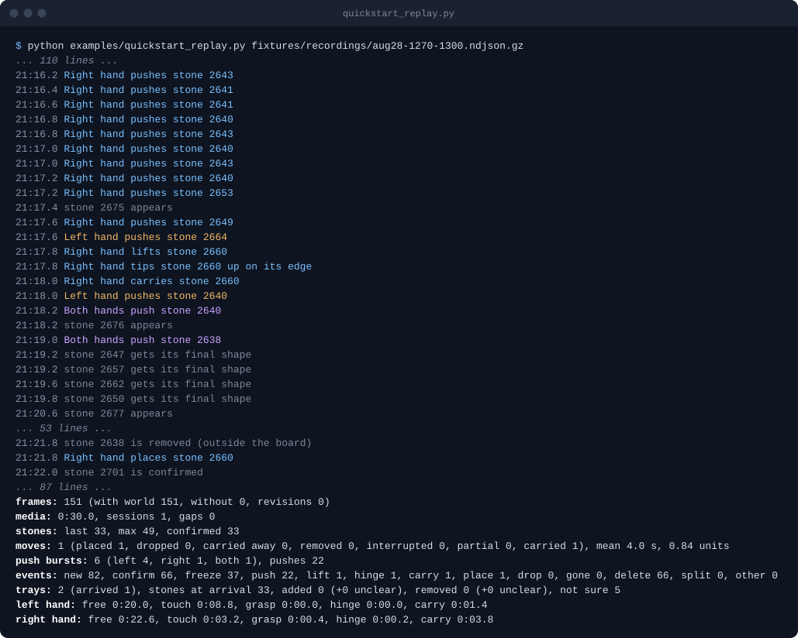

# pDigger Factory SDK for Python

The pDigger Factory unit watches one work area through one camera and interprets it: which hand moved which stone, when,
and where it went. This SDK reads that record from Python with `asyncio`, in two modes. Simple mode is one report per
tray: which stones were taken off, which were put on and which moved, when and where on the tray, and whether that is
the tray's whole account. Advanced mode is the detail underneath, for research and for correcting a report that is not
complete: plain-language events and activities (`21:17.8 Right hand lifts stone 2660`), every tray fact with its reason,
the typed frame streams, and one call per API operation. It replays the published recordings offline, and its `testing`
module answers the API from a recording, so code built on it is tested without a unit.

- Try the API in your browser: https://factory.pdigger.com/developers/api/ (Swagger UI with a demo server)
- Download the recordings: https://factory.pdigger.com/developers/data/
- API reference: built from the docstrings with pdoc (`make docs`, and on every CI run)


## Install

```sh
pip install "pdigger-factory-sdk @ git+https://github.com/eprojac/pdigger-factory-sdk-python"
```

From the first release on, `pip install pdigger-factory-sdk` (PyPI). Python 3.10 or newer. The only dependency is
[httpx](https://www.python-httpx.org/).

## Simple mode: one report per tray

```python
from pdigger_factory_sdk import FactoryClient, Replay

DRY1 = "https://factory.pdigger.com/developers/data/dry1.world.ndjson.gz"


def main(source: str = DRY1) -> None:
    for report in Replay.open(source).tray_reports():
        print(report.describe())


async def follow() -> None:
    async with FactoryClient() as factory:  # PDIGGER_FACTORY_URL, else http://factory-orin.local:8120
        async for report in factory.interpreter().tray_reports():
            print(report.describe())  # report.to_dict() is the same as data, for your MES or ERP
```

`main()` reads a recording, offline; `follow()` gives the same report from a unit as each tray leaves. The report of
the tray in the fixture recording `dry1-0018-0153` (dry1 from 0:18 to 2:33), real output of
[`examples/quickstart_reports.py`](https://github.com/eprojac/pdigger-factory-sdk-python/blob/main/examples/quickstart_reports.py):

```text
tray 1 (2026-11-22T02:38:47.0Z), 0:22.5 to 2:24.0: 11 removed, 13 added, 8 moved, not complete: 18 unclear, 1 not sure
  0:45.5 removed 20261122T023847.0Z-1-117 from (0.68, -1.06) (0.98)
  0:45.5 removed 20261122T023847.0Z-1-127 from (1.14, -1.24) (0.98)
  0:59.4 removed 20261122T023847.0Z-1-126 from (0.35, -1.29) (0.98)
  1:05.4 removed 20261122T023847.0Z-1-105 from (0.49, -0.82) (0.98)
  1:23.6 removed 20261122T023847.0Z-1-112 from (-0.11, -0.84) (0.98)
  1:23.6 removed 20261122T023847.0Z-1-125 from (-0.09, -1.26) (0.98)
  2:24.0 removed 20261122T023847.0Z-1-87 from (0.02, -0.17) (unclear, 0.71)
  2:24.0 removed 20261122T023847.0Z-1-121 from (0.33, -1.27) (unclear, 0.71)
  2:24.0 removed 20261122T023847.0Z-1-128 from (0.56, -1.29) (unclear, 0.71)
  2:24.0 removed 20261122T023847.0Z-1-129 from (0.74, -1.29) (unclear, 0.71)
  2:24.0 removed 20261122T023847.0Z-1-130 from (0.87, -1.27) (unclear, 0.71)
  2:24.0 added 20261122T023943.4Z-1-151 at (0.16, -1.26) (unclear, 0.52)
  2:24.0 added 20261122T024104.0Z-1-177 at (0.02, -0.82) (unclear, 0.96)
```

These are its first fourteen lines; eleven more additions and its eight moves follow. The number that ends each change
is its confidence: how likely it is to be right, from how often changes of its kind were right on 150 trays of the four
complete recordings checked against their video. The unit's speckle check of each tray, part of every report, sets it
([docs/interpreter.md](https://github.com/eprojac/pdigger-factory-sdk-python/blob/main/docs/interpreter.md#confidence)).
Keep the changes at or above a threshold of your own: at 0.90 this tray keeps its six certain removals and nine of its
thirteen additions, all fifteen right by the camera check. Below it are the other two stones that left (87 and 129), a
stone the worker set down (278), three removals of stones that stayed (121, 128 and 130) and three additions of
stones that came in on the tray (151, 246 and 249).

The camera check is the maintainers' offline test (not published) that matches each stone's speckle in the recording's
video, the tray as it arrived against the tray as it left. The worker pushed most of the other stones while squaring the
rows up: the world lost some of them and saw them again under new ids, and the speckle check finds them again as the
tray leaves, so only one stone is still not sure (98, next to a pushed stone). A hand can also take a stone away and set
another one down in its place, so the SDK links a lost stone to a new world id only with evidence that it is the same
stone (the speckle check, their looks, or no hand near either); without it, the lost stone is removed and the new one
added, both unclear, and the stone's id never goes to another stone. Of the thirteen unclear additions, ten are stones
the worker set down and three came in on the tray. Each change gives scene coordinates. A removal gives its last
observed place. An added stone gives its place as the tray left: where it was seen at the leaving point, else where it
was last seen. A stone counted only because the world kept it at the leaving point without a box gives its place in that
world. A stone is reported moved only when the SDK is sure it is the same stone. `not complete` says what is left open:
18 unclear changes and 1 other retained stone with an uncertain identity. Complete means complete as far as the world
sees. A stone the model stops seeing for good while it stays on the tray is removed: for certain when a hand touched it
just before, else unclear (3 of the 52 certain removals in a camera check of the four complete recordings, each one a
stone a hand had moved). A box seen on an empty slot at the arrival becomes a tray stone. A stone the world does not
have as the tray leaves is not in the account. Nor is one it keeps there without a box while a hand holds it, or with
30 % or more of its box under the box of a stone no hand holds (none here: the camera counts 44 stones as the tray
leaves, and so does the account, with world 281, which a hand set down six seconds before and the world kept although
the model had not boxed it yet)
([docs/interpreter.md](https://github.com/eprojac/pdigger-factory-sdk-python/blob/main/docs/interpreter.md#trays-and-tray-stones)).
Advanced mode says that stone by stone ([the first
tutorial](https://github.com/eprojac/pdigger-factory-sdk-python/blob/main/docs/tutorials/00-start-here.md) shows how).

## Advanced mode: follow the camera

```python
import asyncio

from pdigger_factory_sdk import FactoryClient


async def main() -> None:
    async with FactoryClient() as factory:  # PDIGGER_FACTORY_URL, else http://factory-orin.local:8120
        async for event in factory.interpreter().events():
            print(event.describe())  # 21:17.8 Right hand lifts stone 2660


if __name__ == "__main__":
    asyncio.run(main())
```

The interpreter follows the unit's shared session: whatever it shows, one of the plant cameras live or a recording.
Nothing in your code changes between the two ([live cameras](#live-cameras-and-the-shared-session) shows how to
select a camera and wait out its warm-up). If the unit cannot be reached, the
SDK keeps reconnecting and says so on stderr (warnings of the `pdigger_factory_sdk` logger);
`factory.interpreter(max_reconnects=3)` gives up instead ([`examples/reconnects.py`](https://github.com/eprojac/pdigger-factory-sdk-python/blob/main/examples/reconnects.py)).

## Advanced mode: replay a recording

No unit needed. `Replay` streams a published recording (or a local file) and runs the same interpreter over it, in one
pass that prints every event and then the summary:

```python
import sys

from pdigger_factory_sdk import InterpreterCore, Replay

DRY1 = "https://factory.pdigger.com/developers/data/dry1.world.ndjson.gz"


def main(source: str = DRY1) -> None:
    core = InterpreterCore()  # one pass: the events as they are read, then the summary of the same pass
    for event in Replay.open(source).events(core=core):
        print(event.describe())  # 5:02.8 Right hand places stone 643
    print(core.summary().describe(), end="")


if __name__ == "__main__":
    main(*sys.argv[1:2])
```



Real output of [`examples/quickstart_replay.py`](https://github.com/eprojac/pdigger-factory-sdk-python/blob/main/examples/quickstart_replay.py) over the fixture
recording `aug28-1270-1300` (video aug28 from 21:10 to 21:40). It shows the pushes before the right hand lifts stone
2660 at 21:17.8 (frame g 6389), the place at 21:21.8 (g 6409) and the summary of the whole excerpt. The lines left out
are counted on screen. [`tools/terminal_picture.py`](https://github.com/eprojac/pdigger-factory-sdk-python/blob/main/tools/terminal_picture.py) draws the picture, and a
test fails if it no longer matches what the SDK prints.

## Advanced mode, in three layers

**High: the Interpreter.** Typed events, activities (moves and push bursts), the hands, the stones, a summary, and
every one of them as a sentence. It waits for what you ask, and a later loop goes on from where the last one stopped:

```python
interpreter = factory.interpreter()
lift = await interpreter.wait_for("lift", timeout=600)
print(f"First lift: {lift.describe()}")

async with interpreter.updates() as updates:  # goes on right after that lift
    async for update in updates:
        for activity in update.activities:
            kind = "move" if isinstance(activity, Move) else "push"
            print(f"[{kind}] {activity.describe()}")
        for fact in update.tray_facts:  # the SDK's own stone ids: one per stone, never reused
            print(f"[tray] {fact.describe()}")
        if update.state.frames >= frames:
            break
```

**Mid: streams.** Frames with their layers, and the stream's side events: clock, worker, gap and reset. The stream
resumes by itself with `Last-Event-ID`. With `backfill=True` it holds back a frame whose world came late and reads the
world again, so frames reach you in order; `clock_on_connect=True` passes on the shared state after every connect
(the unit sends a clock event only when the state changes):

```python
async with factory.streams.frames(["world"], backfill=True, clock_on_connect=True) as stream:
    async for item in stream:
        match item:
            case FrameItem(frame=frame, is_revision=revised, is_backfill=late):
                world = "no world" if frame.world is None else f"{len(frame.world.stones)} stones"
                note = " (revised)" if revised else " (late world read back)" if late else ""
                print(f"frame g {frame.g} at {clock(frame.t)}: {world}{note}")
```

**Low: the API.** One method for each of the 32 operations, typed models, and a codec for the packed maps, depth and
surfaces:

```python
frame = await api.get_frame("latest", layers=["overlay", "world"])
if frame.overlay is not None and frame.overlay.regions is not None:
    regions = frame.overlay.regions
    stone_map = codec.decode_u8_map(regions.stone, regions.rows, regions.cols)
    cells = stone_map.count() if stone_map else 0
    print(f"frame g {frame.g}: stone cells {cells} of {regions.rows} x {regions.cols}")
```

## Trays: ids never reused, facts never revised

The world's stone ids are the engine tracker's: it renames a stone it lost and found again, and it can give a stone's id
to another one (a stone set down where a removed one lay, a row of equal stones pushed one place along). For anything
that must hold over time, use the tray stones. The interpreter follows each tray from the moment it has arrived and
settled to the moment it is about to move out, and gives every stone on it an id that is never reused, no other tray
stone is ever given it (`20261122T023847.0Z-1-117`: first seen at that UTC time, on tray 1, under world id 117). A tray
stone says whether its identity is still sure, and a fact about it is certain or unclear:
`0:45.5 tray 1: stone 20261122T023847.0Z-1-117 was removed` is certain and is never revised, and what the rules cannot
be sure of is reported as unclear, never guessed. `Replay.trays()` lists the trays with their two points, the ones to
jump between
([`examples/tray_points.py`](https://github.com/eprojac/pdigger-factory-sdk-python/blob/main/examples/tray_points.py)):

```python
trays = await Replay.open(source).atrays()
for tray in trays:
    window = tray.window()
    if window is None:
        continue  # a stop that never settled
    arrived, leaving = window
    print(f"tray {tray.n}: arrived {clock(arrived)}, leaving {clock(leaving)}")
    for stone in tray.stones:
        if stone.status == "removed" and stone.certain:
            print(f"  removed: {stone.id}")
```

On busy trays, where hands push rows of equal stones, the tray rules alone lose track of many stones; as the tray
leaves, the unit's speckle check settles most of them again (on the published recordings 95.6 % of the stones are sure
as their tray leaves where it answers), and every change carries its confidence. Without an answer for the leaving
(hands still at work after the tray's last calm frame), most of those stones stay not sure and the stones set down are
mostly reported as unclear. The SDK sees only the world: a box the model sees on an empty slot when the tray arrives
cannot be told from a stone, and a stone the model stops seeing for good while it stays on the tray looks removed
([docs/interpreter.md](https://github.com/eprojac/pdigger-factory-sdk-python/blob/main/docs/interpreter.md#trays-and-tray-stones)).

## Live cameras and the shared session

The unit has one shared session: one source, one playhead and one interpretation, the same for every viewer. A control
(`watch`, `seek`, `pause`, `play`, `focus`) changes it for everybody, so every control takes `dry_run=True`:

```python
cameras = [s for s in sources if s.is_live]
target = cameras[0].id if cameras else sources[0].id
would = await factory.session.watch(target, dry_run=True)
print(f"watching {target} would start session {would.session} at {clock(would.anchor_media)}")
```

The plant cameras are sources like the recordings, listed after them by their serials: `factory.cameras()`. Watching one
starts a session that is `connecting` until the camera's first frame, then `warming` while the interpreter runs on its
first 3 seconds of frames (none of them is shown), then `live`; `session.until_live()` waits for that (the select counts
as a viewer for 15 s, so this works on a unit nobody else watches):

```python
await factory.session.watch(camera)  # connecting, then warming up on the camera's first 3 s
state = await factory.session.until_live()
lag = state.live.lag if state.live else 0.0
print(f"{camera.id} ({camera.title}) is live: session {state.session}, {lag:.2f} s behind the camera")

picture = await factory.session.picture()  # the JPEG the newest frame was interpreted from
print(f"frame g {picture.g}: a {len(picture.jpeg)}-byte JPEG")
```

From then on the frames, the world and the events stream as on a recording
([examples/live_camera.py](https://github.com/eprojac/pdigger-factory-sdk-python/blob/main/examples/live_camera.py)), at
the camera's rate as far as the worker keeps up: on the plant rigs 1.6 to 3.9 frames a second on build
`claude-20261120-looks1`, and about 3.6 a second on build `claude-20261122-hr4x1`, whose worker takes 274 ms a camera
frame. A camera has no time: `watch(camera, at=...)` and a
seek raise `not_seekable` without sending the select or the seek (a seek reads the session first, a watch of an id reads
the catalog; the unit refuses a select with a time with 400 and a seek with 409), `pause` freezes the shared view, and
`play` continues at the live edge after a new warm-up. A camera has no media either: every frame comes with its picture
(`session.picture(g)`). Events carry a wall time, from the shared state, which on a camera is the timestamp that
matters. [docs/concepts.md](https://github.com/eprojac/pdigger-factory-sdk-python/blob/main/docs/concepts.md) explains
the session, and
[docs/BEHAVIOUR-20.20.md](https://github.com/eprojac/pdigger-factory-sdk-python/blob/main/docs/BEHAVIOUR-20.20.md) gives
measurements of the 20.20 unit and its live cameras.

## Errors

Every failure of the API, its streams and recordings is a `FactoryError`, from a base URL that cannot work
(`invalid_param`, raised when the client is made) and a refused connection (`transport`) to a reply or a recording
that does not decode or ends early (`decode`) and a call on a closed client (`stream_closed`). Besides it only Python's
own errors reach you, each where it is documented: `OSError` for a local file, `TimeoutError` from `wait_for`,
`ValueError` for arguments that cannot work, and `RuntimeError` for a second loop over one interpreter. Its
`code` is stable (the API's error code, or one of the SDK's own: `transport`, `decode`, `live_unavailable`,
`live_timeout` and `stream_closed`), so branch on the code, never on the message:

```python
try:
    camera = await factory.live()
    print(f"live camera: {camera.title}")
except FactoryError as e:
    if e.code != ErrorCode.LIVE_UNAVAILABLE:
        raise
    print(f"no live camera: {e.message}")
```

It also carries `status`, `field`, `retry_ms`, `retained` (the frame window a `not_retained` error reports) and
`waiting`, and the helpers `is_retryable`, `is_not_retained` and `is_session_gone`. Reads (GET and HEAD) are retried
on connection errors and on 429, 502, 503 and 504. A control is retried only on 429, which the server sends before it
applies anything. A retry waits as long as the server asks (`retry_ms`, `Retry-After` in seconds or as a date), or
else backs off: 0.25 s doubling to 5 s, with full jitter. A `FactoryError` pickles, so it crosses process boundaries
(multiprocessing, task queues).

## Async notes

- One `FactoryClient` per server. Share it between tasks; it holds the connection pool.
- Every stream is an `AsyncStream`: iterate it with `async for` inside `async with`, and leaving the block (`break`
  too), `aclose()` or cancelling the task closes its HTTP connection. A stream abandoned otherwise is closed only when
  it is garbage-collected.
- Streams resume on their own, so the interpreter's loops never end while the unit runs. Bound them with your own
  condition, `asyncio.timeout()` (Python 3.11+) or `wait_for(..., timeout=...)`.
- By default a stream counts as a viewer (`observe=False`). That keeps the worker interpreting: with nobody watching,
  the unit interprets nothing. `observe=True` watches without keeping it busy.
- `Replay` has plain iterators for scripts and async ones (`aevents()`, `aactivities()`, `aheader()` ...) that never
  block the event loop (a local file is read in a worker thread, the loop gets a turn after every frame) and can pace
  frames in real time.
- The SDK logs reconnects, backoff waits and late layers to the `pdigger_factory_sdk` logger and installs no handler.
- Time and randomness are injectable (`sleep`, `monotonic`, `wall_clock`, `rng`), which is how the tests run without
  waiting.

## Test your code without a unit

`FakeFactory` is an httpx transport that answers the whole API from a recording, with fault injection and a live
camera emulated. Resuming loops never end on their own, so the fake ends them with `FakeExhausted` when its recording
runs out:

```python
async def test_count_moves() -> None:
    fake = FakeFactory(recording=RECORDING)
    async with FactoryClient("http://fake", transport=fake, sleep=fake.time.sleep) as factory:
        assert await count_moves(factory, limit=44) == {"carried_away": 2, "dropped": 1, "placed": 4}
```

In your own project the recording must be there too: copy the fixture the test reads from this repository's
`fixtures/recordings/`, or download a published recording from https://factory.pdigger.com/developers/data/.

## Documentation

| | |
|---|---|
| [docs/tutorials/](https://github.com/eprojac/pdigger-factory-sdk-python/tree/main/docs/tutorials) | start here: five short tutorials, from one report per tray to the low level, live cameras and Python, each step a program the tests run |
| [docs/concepts.md](https://github.com/eprojac/pdigger-factory-sdk-python/blob/main/docs/concepts.md) | the shared session, sources and the live cameras, frames, layers, cursors, revisions, coordinates |
| [docs/interpreter.md](https://github.com/eprojac/pdigger-factory-sdk-python/blob/main/docs/interpreter.md) | events, activities, trays and tray stones, the text, the summary |
| [docs/streams.md](https://github.com/eprojac/pdigger-factory-sdk-python/blob/main/docs/streams.md) | frames, side events, resume, backfill, long-poll, raw packets, logging |
| [docs/low-level.md](https://github.com/eprojac/pdigger-factory-sdk-python/blob/main/docs/low-level.md) | every operation, models, errors, retries, the codec |
| [docs/replay.md](https://github.com/eprojac/pdigger-factory-sdk-python/blob/main/docs/replay.md) | recordings: files, URLs, pacing, the format |
| [docs/testing.md](https://github.com/eprojac/pdigger-factory-sdk-python/blob/main/docs/testing.md) | `FakeFactory`, fault injection, fake time |
| [examples/](https://github.com/eprojac/pdigger-factory-sdk-python/tree/main/examples) | every program in these docs; the tests run each one |

## The four languages

In every language the SDK reads the API the same way, and the same recording gives byte-identical text in all four.
They follow one contract, [spec/SDK-DESIGN.md](https://github.com/eprojac/pdigger-factory-sdk-python/blob/main/spec/SDK-DESIGN.md); the API is [spec/openapi.yaml](https://github.com/eprojac/pdigger-factory-sdk-python/blob/main/spec/openapi.yaml).

| | [Go](https://github.com/eprojac/pdigger-factory-sdk-go) | Python | [Rust](https://github.com/eprojac/pdigger-factory-sdk-rust) | [TypeScript](https://github.com/eprojac/pdigger-factory-sdk-ts) |
|---|---|---|---|---|
| Package | `github.com/eprojac/pdigger-factory-sdk-go` | `pdigger-factory-sdk` (PyPI, from its first release) | `pdigger-factory-sdk` (crates.io, from its first release) | `pdigger-factory-sdk` (npm, from its first release) |
| Interpreter: events, moves, push bursts, hands, stones, summary, text, `wait_for` | ✓ | ✓ | ✓ | ✓ |
| Trays: stone ids never reused, certain and unclear facts never revised, arrival and leaving points | ✓ | ✓ | ✓ | ✓ |
| Replay of a file or URL, with real-time pacing | ✓ | ✓ | ✓ | ✓ |
| Sources, the live cameras, session controls with `dry_run`, the shared clock | ✓ | ✓ | ✓ | ✓ |
| Frame streams with resume and backfill; long-poll; raw packets | ✓ | ✓ | ✓ | ✓ |
| Render-ready overlay2d and scene3d draw lists | ✓ | ✓ | ✓ | ✓ |
| One method per operation (32), typed models and errors, retries | ✓ | ✓ | ✓ | ✓ |
| Codec: maps, bitsets, depth, surfaces, joints, stone tuples, coordinates | ✓ | ✓ | ✓ | ✓ |
| `testing`: a fake server from recordings, with fault injection | ✓ | ✓ | ✓ | ✓ |
| Visualisation helpers | | | egui viewer | three.js views |
| Async | `context`, `iter.Seq2` | `asyncio` | `async fn`, `Stream` | `Promise`, `AsyncIterable` |

## Development

`make test` runs the linters, the type checks and the unit tests in Docker with no network, and fails below 100 % line
and branch coverage. The golden tests replay every recording in `fixtures/` and compare the events, activities, tray
facts and summary with the reference outputs byte for byte. [CONTRIBUTING.md](https://github.com/eprojac/pdigger-factory-sdk-python/blob/main/CONTRIBUTING.md) covers the workflow and
[TESTING.md](https://github.com/eprojac/pdigger-factory-sdk-python/blob/main/TESTING.md) the opt-in tests against a unit or the complete recordings.

## Licence

Apache License 2.0; see [LICENSE](https://github.com/eprojac/pdigger-factory-sdk-python/blob/main/LICENSE) and [NOTICE](https://github.com/eprojac/pdigger-factory-sdk-python/blob/main/NOTICE).
