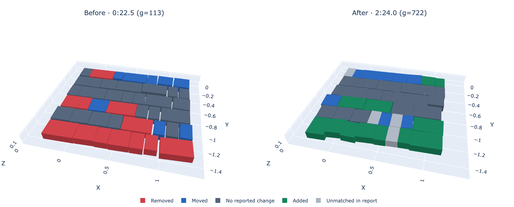

# 3D tray reports

[Open the interactive 3D demo](https://eprojac.github.io/pdigger-factory-sdk-python/) to see tray 1 when it settled and just before it left. Drag or zoom either view to move both together. Hover over a stone to inspect it.

The sample report lists 11 removals, 13 additions and 8 moves. Expand **Reported changes** below the plot to see
the confidence score for each change. To explore the same view offline, download the [standalone HTML](demo/tray-1.html)
and open it in your browser.

## Run your own recording

Open the notebook in Colab, set `SOURCE_MODE` to `upload`, `path` or `url`, and choose **Runtime → Run all**.
For a path or URL, enter it in `RECORDING`. Pick a `REPORT_NUMBER` from the table and rerun the comparison cell.
Set `EXPORT` to `True` to save the 3D view as HTML and the full report as JSON.
[Open in Colab](https://colab.research.google.com/github/eprojac/pdigger-factory-sdk-python/blob/main/notebooks/pDigger_Factory_3D_Tray_Reports.ipynb) · [View the notebook on GitHub](pDigger_Factory_3D_Tray_Reports.ipynb)
